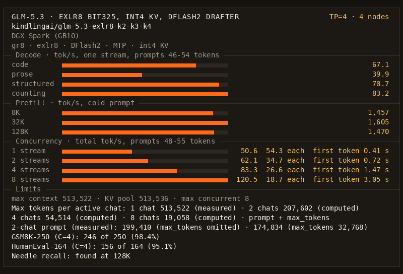

# KindlingAI: GLM-5.3 EXLR8 on four DGX Sparks

If you are an agent booting this for someone, read [AGENTS.md](AGENTS.md) first, then the Quickstart.

_**Join our discord to learn more about KindlingAI and `gr8`: https://discord.gg/8EAvYPV2rE**_

Full GLM-5.3 on four DGX Sparks (GB10, 128 GB each) at TP=4, served by [gr8](https://github.com/kindlingai/gr8) `v1.1.0` from
the `bit325` width profile of [kindlingai/glm-5.3-exlr8-k2-k3-k4](https://huggingface.co/kindlingai/glm-5.3-exlr8-k2-k3-k4/tree/3e388b45b26ca4558351d22994afcfc85b99af74) (v0.6). This recipe is gr8's
default GLM-5.3 setup: the published gr8 image, pinned by digest, and one `.env` file. Nothing is compiled.



67.1 tok/s for one request writing code (73.2 tok/s in fast mode) · 1,605 tok/s prefill on a 32K prompt (1,470 tok/s at 128K) · 8 requests at once, 120.5 tok/s in total (139.0 tok/s in fast mode) · 13.5+ GiB free memory per box · a 513,536-token KV pool · a fact hidden in a 128K prompt found

## Results

Four DGX Sparks on a 200G switch, TP=4, `gr8 v1.1.0` (`cdd1e09`), this recipe's `.env` (`bit325` v0.6 experts, int4 KV, DFlash2 + MTP drafter, default quality preset `MOE_UNION_CAP=48`), measured 2026-11-20 with gr8's own benchmark (`bench/bench.py`, default level), one fresh boot. GPU clocks were uncapped in the timed stages. Every speed is in tokens per second (tok/s).

One request, short prompts (46-54 tokens, up to 512 tokens out, 6 runs each):

| work | code | prose | structured | counting |
|---|---|---|---|---|
| tok/s, mean | 67.1 | 39.9 | 78.7 | 83.2 |
| lowest - highest run | 58.0 - 76.9 | 37.6 - 42.1 | 70.7 - 85.3 | 82.0 - 84.1 |

Prefill, cold prompt (one run each):

| prompt | first token | prefill tok/s | decode after it | first token, same prompt again (cached) |
|---|---|---|---|---|
| 8K tokens | 5.66 s | 1,457 | 35.6 tok/s | 0.17 s |
| 32K tokens | 20.42 s | 1,605 | 33.0 tok/s | 0.24 s |
| 128K tokens | 89.28 s | 1,470 | 32.5 tok/s | 0.37 s |

Requests at once (short mixed prompts, 48-55 tokens, up to 512 tokens out each):

| requests at once | 1 | 2 | 4 | 8 |
|---|---|---|---|---|
| total tok/s (quality default, `MOE_UNION_CAP=48`) | 50.6 | 62.1 | 83.3 | 120.5 |
| tok/s per request (quality default) | 54.3 | 34.7 | 26.6 | 18.7 |
| first token, median | 0.41 s | 0.72 s | 1.47 s | 3.05 s |

### Speed and quality presets (`MOE_UNION_CAP`)

`gr8 v1.1.0` enables eight bit-exact decode, prefill, and DFlash2 kernels by default (`KL = 0.00000`) plus `DEC_BK_MAX=2048` (leaving over 13.5 GiB free memory per box instead of 2.3 GiB) and a batch-budgeted MoE expert union cap (`MOE_UNION_CAP`):

| preset (`.env`) | code decode | 4 streams total (per req) | 8 streams total (per req) | GSM8K-250 (C=4) | HumanEval-164 (C=4) |
|---|---:|---:|---:|---:|---:|
| **Quality (default, `MOE_UNION_CAP=48`)** | 67.1 tok/s | 83.3 (26.6) tok/s | 120.5 (18.7) tok/s | 246 / 250 (98.4%) | 156 / 164 (95.1%) |
| **Fast (`MOE_UNION_CAP=32`)** | 73.2 tok/s | 97.1 (32.6) tok/s | 139.0 (22.6) tok/s | 242 / 250 (96.8%) | 153 / 164 (93.3%) |
| **Uncapped exact (`MOE_UNION_CAP=0`)** | exact (`KL=0`) | — | — | 244 / 250 (97.6%) | 157 / 164 (95.7%) |

Fast mode (`MOE_UNION_CAP=32`) was measured on the same boot sequence on 2026-11-20 (`bench/bench.py --quick`, 38.9 tok/s prose, 1,597 / 1,587 / 1,469 tok/s prefill at 8K / 32K / 128K, 0 suspect characters, 13.26 GiB lowest `MemAvailable`). On sustained 4 × 153.6K concurrent long context (615K resident tokens in local RAM), `MOE_UNION_CAP=32` measured 43.0 tok/s aggregate (+13.3% vs 37.9 uncapped) with 8/8 passkey needles found.

How long each chat can be. The KV pool holds 513,536 tokens, and each chat reserves its prompt plus `max_tokens`
(8,192 when `max_tokens` is omitted), so the limit for each chat depends on how many chats are active:

| active chats | 1 | 2 | 4 | 8 |
|---|---:|---:|---:|---:|
| max tokens per chat (prompt + `max_tokens`) | 513,522 | 207,602 | 54,514 | 19,058 |

The 1-chat value is measured (the served `max_model_len`); the others are computed from the pool size. Measured with
2 chats: the longest prompt before a chat is evicted is 199,410 tokens with `max_tokens` omitted and 174,834 tokens at
`max_tokens=32768`.

Checks on the same `v1.1.0` default boot:

| check | result |
|---|---|
| smoke test | 14 of 14 |
| fact hidden in a 130,813-token prompt | found |
| count to 200, three times | 3 of 3 clean |
| prompt cache | 422 of 423 cached |
| suspect characters | 0 replies |
| GSM8K-250 / HumanEval-164 (C=4, `MOE_UNION_CAP=48`) | 246 of 250 (98.4%) / 156 of 164 (95.1%) |
| longest context (`max_model_len`) | 513,522 tokens |
| lowest `MemAvailable` recorded on any box | 13.53 GiB (13.98 - 14.54 GiB after boot) |

int4 KV stores the attention latent in 4 bits. It is the launcher's default at TP=4 because it gives a larger KV pool
at the same speed. `KV_FORMAT=fp8` in `.env` gives the earlier format, with a 485,376-token pool
([gr8 KV4.md](https://github.com/kindlingai/gr8/blob/main/docs/KV4.md)).

[kindling.json](kindling.json) has these numbers in a form a program can read. The card above is drawn from it.

## Quickstart

On every box, first turn off proactive memory compaction and open TCP ports 7340 and 7341 between the boxes
([What you need](#what-you-need)). Then, on every box:

```bash
git clone https://github.com/kindlingai/glm-5.3-exlr8-4x-spark && cd glm-5.3-exlr8-4x-spark
cp .env.example .env
nano .env                  # PEERS: the four LAN addresses, head first. The same file on every box.
docker compose up -d       # pulls the pinned gr8 image; the first boot fetches this box's part of the model
docker compose logs -f     # this box's supervisor; ready when the cluster serves
```

Then, on the head (the first address in `PEERS`):

```bash
docker compose exec gr8 /opt/gr8/gr8 glm53 smoke
curl -s localhost:8100/v1/models
```

The head serves an OpenAI-compatible API on port 8100. Stop the cluster with
`docker compose exec gr8 /opt/gr8/gr8 glm53 down` on the head, then `docker compose down` on every box.

A box that ran the earlier form of this recipe (its own image) has its part of the model in the docker volume
`glm53-4x-cache`. To use that volume again, set `GR8_CACHE` in `.env` to its directory
(`docker volume inspect glm53-4x-cache --format '{{.Mountpoint}}'`). The cache is keyed by Hugging Face commit: the box
reads what the volume holds at the commits pinned in `.env`, and fetches the rest.

## What you need

- Four DGX Sparks or other GB10 boxes (128 GB unified memory), with nothing else holding much memory. A box runs
  one model at a time.
- A RoCE v2 fabric between the ConnectX-7 ports: one 200G switch, or the four boxes cabled in a ring (`SHAPE=ring`,
  about 10% slower single-stream decode).
- A LAN between the boxes with TCP ports 7340 and 7341 open.
- Docker with the NVIDIA container toolkit (DGX OS has both).
- About 90 GB of disk a box for the model, 200 GB for the SSD KV store as set in `.env.example`, and about 70 GiB
  more if you run `prepare` for the compact copies.
- Proactive memory compaction off on every box:
  `sudo sysctl -w vm.compaction_proactiveness=0` (gr8's
  [DEPLOY.md](https://github.com/kindlingai/gr8/blob/main/docs/DEPLOY.md#before-you-start) has the permanent form).

gr8's [GLM-5.3 page](https://github.com/kindlingai/gr8/blob/main/docs/GLM-5.3.md) explains how the engine works, and
[DEPLOY.md](https://github.com/kindlingai/gr8/blob/main/docs/DEPLOY.md) explains every setting.

## Other box counts

The same image and the same `compose.yaml` serve GLM-5.3 on three, five or six boxes: put three, five or six
addresses in `PEERS`, and remove the `DRAFTER` line and the two `GR8_LOAD_COMPACT` / `GR8_LOAD_MERGE_KB` settings
(both are for TP=4). The launcher picks each width's defaults.

These rows are older than the TP=4 results above. They were measured on 2026-10-24 with
[RigMark](https://github.com/alexellis/rigmark) 1.0.0, the mean of two fresh boots, with the launcher defaults of
that date (fp8 KV, MTP drafting). They were not measured again on the pinned engine.

| | TP=3 | TP=5 | TP=6 |
|---|---|---|---|
| experts | `bit225`, 2.25 bpw | `home`, 3.25 bpw | `home`, 3.25 bpw |
| decode, code / prose | 41.1 / 31.7 tok/s | 51.0 / 38.0 tok/s | 57.4 / 43.1 tok/s |
| total, 2 / 4 requests at once | 50.6 / 63.8 tok/s | 61.8 / 76.3 tok/s | 67.6 / 85.5 tok/s |
| prefill, 8K prompt, cold | 635 tok/s | 1,554 tok/s | 1,808 tok/s |
| KV pool (longest context) | 307,136 tokens | 502,848 tokens | 614,400 tokens |

At TP=6 one of the six boxes was capped at 2200 MHz.

For five or six boxes with a longer context and tuned settings, use the recipes
[glm-5.3-exlr8-5x-spark](https://github.com/kindlingai/glm-5.3-exlr8-5x-spark) (737K context) and
[glm-5.3-exlr8-6x-spark](https://github.com/kindlingai/glm-5.3-exlr8-6x-spark) (1M context).

## Help

Ask on Discord (https://discord.gg/8EAvYPV2rE) or open an issue in this repo
(https://github.com/kindlingai/glm-5.3-exlr8-4x-spark/issues). Say which step failed, and include:

- the command you ran, and the end of `docker logs glm53-4x-spark`, before you remove the container;
- if it still runs, `docker exec glm53-4x-spark /opt/gr8/gr8 glm53 status`.

Remove addresses and hostnames before you post.

## Engine pin

This recipe has no engine code. It runs one published gr8 image, named by tag and digest in
[compose.yaml](compose.yaml) and in the `engine` field of [kindling.json](kindling.json):

| | |
|---|---|
| engine | [kindlingai/gr8](https://github.com/kindlingai/gr8) [`v1.1.0`](https://github.com/kindlingai/gr8/releases/tag/v1.1.0) at [`cdd1e09`](https://github.com/kindlingai/gr8/commit/cdd1e0931047f55bba8f682a0ae79c4198668ca3) |
| image | `ghcr.io/kindlingai/gr8:v1.1.0` |
| digest | `sha256:b22eedbd7902f65dbf2090897d75f5d92276cbf78a16bcde1f958aa56a306cf7` |

All TP=4 results above were measured on 2026-11-20 directly on this pinned `gr8 v1.1.0` image (`sha256:b22eedbd...`).

After v1.0, the pin moves to a newer gr8 release only after this recipe was booted and measured on it. `python3 check.py` checks
that `compose.yaml` and `kindling.json` name the same image; CI runs it on every pull request.

## License

MIT, see [LICENSE](LICENSE). GLM-5.3 and the DFlash2 drafter have their own licences: see the
[model page](https://huggingface.co/kindlingai/glm-5.3-exlr8-k2-k3-k4) and
[incoai/GLM-5.3-DFlash2](https://huggingface.co/incoai/GLM-5.3-DFlash2) (CC BY-NC-ND).
