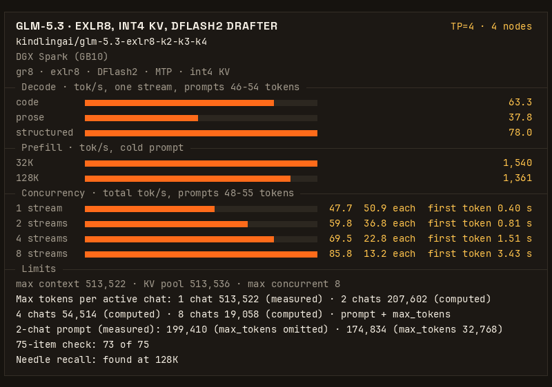

# KindlingAI: GLM-5.3 EXLR8 on four DGX Sparks

If you are an agent booting this for someone, read [AGENTS.md](AGENTS.md) first, then the Quickstart.

_**Join our discord to learn more about KindlingAI and `gr8`: https://discord.gg/8EAvYPV2rE**_

Full GLM-5.3 on four DGX Sparks (GB10, 128 GB each) at TP=4, served by [gr8](https://github.com/kindlingai/gr8) from
[kindlingai/glm-5.3-exlr8-k2-k3-k4](https://huggingface.co/kindlingai/glm-5.3-exlr8-k2-k3-k4). This recipe is gr8's
default GLM-5.3 setup: the published gr8 image, pinned by digest, and one `.env` file. Nothing is compiled.



63.3 tok/s for one request writing code · 1,540 tok/s prefill on a 32K prompt · 8 requests at once, 85.8 tok/s in
total · a 513,536-token KV pool (max tokens per active chat: 513,522 at 1, 207,602 at 2) · a fact hidden in a 128K prompt found

## Results

Four DGX Sparks, TP=4, this recipe's `.env` (int4 KV, DFlash2 drafter, SSD KV store), measured 2026-11-11 with gr8's
own benchmark (`bench/bench.py`, default level), one boot. GPU clocks were uncapped in the timed stages. The build
was a staged image of gr8 [#490](https://github.com/kindlingai/gr8/pull/490) before it merged; the recipe pins
gr8 v1.0.1, which has it (see [Engine pin](#engine-pin)). Every speed is in tokens per second (tok/s).

One request, short prompts (46-54 tokens, up to 512 tokens out, 6 runs each):

| work | code | prose | structured | counting |
|---|---|---|---|---|
| tok/s, mean | 63.3 | 37.8 | 78.0 | 81.5 |
| lowest - highest run | 52.9 - 75.4 | 35.9 - 42.9 | 71.4 - 83.4 | 80.4 - 82.5 |

Prefill, cold prompt (one run each):

| prompt | first token | prefill tok/s | decode after it | first token, same prompt again (cached) |
|---|---|---|---|---|
| 32K tokens | 21.2 s | 1,540 | 33.7 tok/s | 0.21 s |
| 128K tokens | 96.3 s | 1,361 | 30.6 tok/s | 0.32 s |

Requests at once (short mixed prompts, 48-55 tokens, up to 512 tokens out each):

| requests at once | 1 | 2 | 4 | 8 |
|---|---|---|---|---|
| total tok/s | 47.7 | 59.8 | 69.5 | 85.8 |
| tok/s per request | 50.9 | 36.8 | 22.8 | 13.2 |
| first token, median | 0.40 s | 0.81 s | 1.51 s | 3.43 s |

How long each chat can be. The KV pool holds 513,536 tokens, and each chat reserves its prompt plus `max_tokens`
(8,192 when `max_tokens` is omitted), so the limit for each chat depends on how many chats are active:

| active chats | 1 | 2 | 4 | 8 |
|---|---:|---:|---:|---:|
| max tokens per chat (prompt + `max_tokens`) | 513,522 | 207,602 | 54,514 | 19,058 |

The 1-chat value is measured (the served `max_model_len`); the others are computed from the pool size. Measured with
2 chats: the longest prompt before a chat is evicted is 199,410 tokens with `max_tokens` omitted and 174,834 tokens at
`max_tokens=32768`.

Checks on the same boot:

| check | result |
|---|---|
| smoke test | 14 of 14 |
| fact hidden in a 131,006-token prompt | found |
| count to 200, three times | 3 of 3 clean |
| 75-item quality check (code, math, prose) | 73 of 75; the fp8 KV format scored 74 of 75 on the same boxes that day |
| KL against the fp8 KV format, 4,096 positions | mean 0.0145, top-1 agreement 97.0% |
| longest context (`max_model_len`) | 513,522 tokens |
| lowest `MemAvailable` recorded on any box | 2.3 GB |

int4 KV stores the attention latent in 4 bits. It is the launcher's default at TP=4 because it gives a larger KV pool
at the same speed. `KV_FORMAT=fp8` in `.env` gives the earlier format, with a 485,376-token pool
([gr8 KV4.md](https://github.com/kindlingai/gr8/blob/main/docs/KV4.md)).

[kindling.json](kindling.json) has these numbers in a form a program can read. The card above is drawn from it.

## Quickstart

On every box, first turn off proactive memory compaction and open TCP ports 7340 and 7341 between the boxes
([What you need](#what-you-need)). Then, on every box:

```bash
git clone https://github.com/kindlingai/glm-5.3-exlr8-4x-spark && cd glm-5.3-exlr8-4x-spark
cp .env.example .env
nano .env                  # PEERS: the four LAN addresses, head first. The same file on every box.
docker compose up -d       # pulls the pinned gr8 image; the first boot fetches this box's part of the model
docker compose logs -f     # this box's supervisor; ready when the cluster serves
```

Then, on the head (the first address in `PEERS`):

```bash
docker compose exec gr8 /opt/gr8/gr8 glm53 smoke
curl -s localhost:8100/v1/models
```

The head serves an OpenAI-compatible API on port 8100. Stop the cluster with
`docker compose exec gr8 /opt/gr8/gr8 glm53 down` on the head, then `docker compose down` on every box.

A box that ran the earlier form of this recipe (its own image) has its part of the model in the docker volume
`glm53-4x-cache`. To use that volume again, set `GR8_CACHE` in `.env` to its directory
(`docker volume inspect glm53-4x-cache --format '{{.Mountpoint}}'`). The cache is keyed by Hugging Face commit: the box
reads what the volume holds at the commits pinned in `.env`, and fetches the rest.

## What you need

- Four DGX Sparks or other GB10 boxes (128 GB unified memory), with nothing else holding much memory. A box runs
  one model at a time.
- A RoCE v2 fabric between the ConnectX-7 ports: one 200G switch, or the four boxes cabled in a ring (`SHAPE=ring`,
  about 10% slower single-stream decode).
- A LAN between the boxes with TCP ports 7340 and 7341 open.
- Docker with the NVIDIA container toolkit (DGX OS has both).
- About 90 GB of disk a box for the model, 200 GB for the SSD KV store as set in `.env.example`, and about 70 GiB
  more if you run `prepare` for the compact copies.
- Proactive memory compaction off on every box:
  `sudo sysctl -w vm.compaction_proactiveness=0` (gr8's
  [DEPLOY.md](https://github.com/kindlingai/gr8/blob/main/docs/DEPLOY.md#before-you-start) has the permanent form).

gr8's [GLM-5.3 page](https://github.com/kindlingai/gr8/blob/main/docs/GLM-5.3.md) explains how the engine works, and
[DEPLOY.md](https://github.com/kindlingai/gr8/blob/main/docs/DEPLOY.md) explains every setting.

## Other box counts

The same image and the same `compose.yaml` serve GLM-5.3 on three, five or six boxes: put three, five or six
addresses in `PEERS`, and remove the `DRAFTER` line and the two `GR8_LOAD_COMPACT` / `GR8_LOAD_MERGE_KB` settings
(both are for TP=4). The launcher picks each width's defaults.

These rows are older than the TP=4 results above. They were measured on 2026-10-24 with
[RigMark](https://github.com/alexellis/rigmark) 1.0.0, the mean of two fresh boots, with the launcher defaults of
that date (fp8 KV, MTP drafting). They were not measured again on the pinned engine.

| | TP=3 | TP=5 | TP=6 |
|---|---|---|---|
| experts | `bit225`, 2.25 bpw | `home`, 3.25 bpw | `home`, 3.25 bpw |
| decode, code / prose | 41.1 / 31.7 tok/s | 51.0 / 38.0 tok/s | 57.4 / 43.1 tok/s |
| total, 2 / 4 requests at once | 50.6 / 63.8 tok/s | 61.8 / 76.3 tok/s | 67.6 / 85.5 tok/s |
| prefill, 8K prompt, cold | 635 tok/s | 1,554 tok/s | 1,808 tok/s |
| KV pool (longest context) | 307,136 tokens | 502,848 tokens | 614,400 tokens |

At TP=6 one of the six boxes was capped at 2200 MHz.

For five or six boxes with a longer context and tuned settings, use the recipes
[glm-5.3-exlr8-5x-spark](https://github.com/kindlingai/glm-5.3-exlr8-5x-spark) (617K context) and
[glm-5.3-exlr8-6x-spark](https://github.com/kindlingai/glm-5.3-exlr8-6x-spark) (613K context).

## Help

Ask on Discord (https://discord.gg/8EAvYPV2rE) or open an issue in this repo
(https://github.com/kindlingai/glm-5.3-exlr8-4x-spark/issues). Say which step failed, and include:

- the command you ran, and the end of `docker logs glm53-4x-spark`, before you remove the container;
- if it still runs, `docker exec glm53-4x-spark /opt/gr8/gr8 glm53 status`.

Remove addresses and hostnames before you post.

## Engine pin

This recipe has no engine code. It runs one published gr8 image, named by tag and digest in
[compose.yaml](compose.yaml) and in the `engine` field of [kindling.json](kindling.json):

| | |
|---|---|
| engine | [kindlingai/gr8](https://github.com/kindlingai/gr8) [`v1.0.1`](https://github.com/kindlingai/gr8/releases/tag/v1.0.1) at [`6333c78`](https://github.com/kindlingai/gr8/commit/6333c78a4ab4cfedc706793d689f54858c576d84) |
| image | `ghcr.io/kindlingai/gr8:v1.0.1` |
| digest | `sha256:02e44b9fc971f2acffe117df50de1be829462453287aab2c1d61a31a55738c0b` |

The speed and quality results above were measured on 2026-11-11 on a staged image of gr8 [#490](https://github.com/kindlingai/gr8/pull/490), which merged as commit [`a555ee2`](https://github.com/kindlingai/gr8/commit/a555ee2a078946332769b5cd412ba3c73c46e242). `v1.0.1` ([`6333c78`](https://github.com/kindlingai/gr8/commit/6333c78a4ab4cfedc706793d689f54858c576d84)) updates the persistent SSD KV store (`KV_STORE` in `.env.example`) to preallocate its block file at boot, write only newly added KV blocks when a resumed chat continues ([#484](https://github.com/kindlingai/gr8/pull/484)), and persist steered chats alongside unsteered ones ([#498](https://github.com/kindlingai/gr8/pull/498)), verified on four DGX Sparks at TP=4 on 2026-11-12.

After v1.0, the pin moves to a newer gr8 release only after this recipe was booted and measured on it. `python3 check.py` checks
that `compose.yaml` and `kindling.json` name the same image; CI runs it on every pull request.

## License

MIT, see [LICENSE](LICENSE). GLM-5.3 and the DFlash2 drafter have their own licences: see the
[model page](https://huggingface.co/kindlingai/glm-5.3-exlr8-k2-k3-k4) and
[incoai/GLM-5.3-DFlash2](https://huggingface.co/incoai/GLM-5.3-DFlash2) (CC BY-NC-ND).
